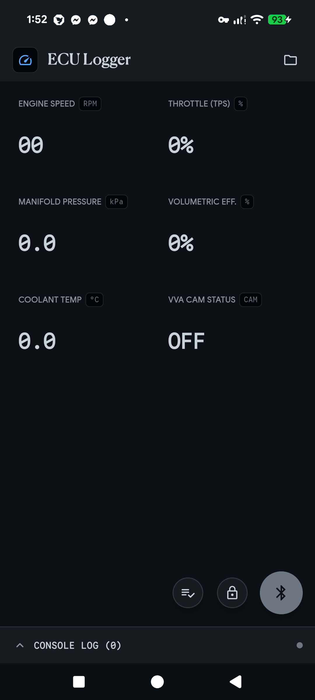
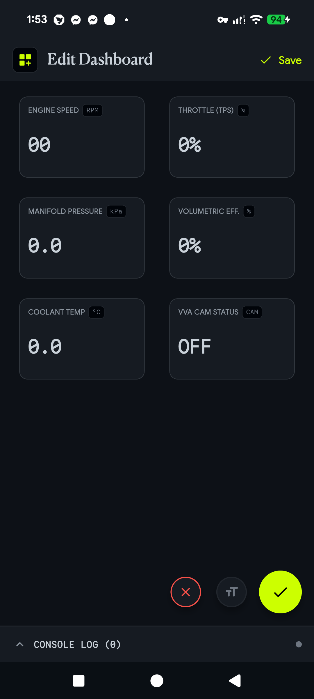
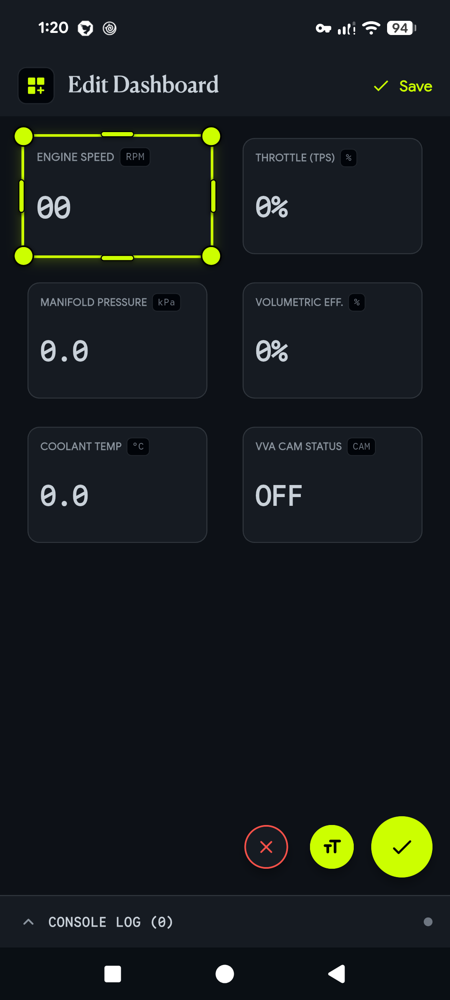
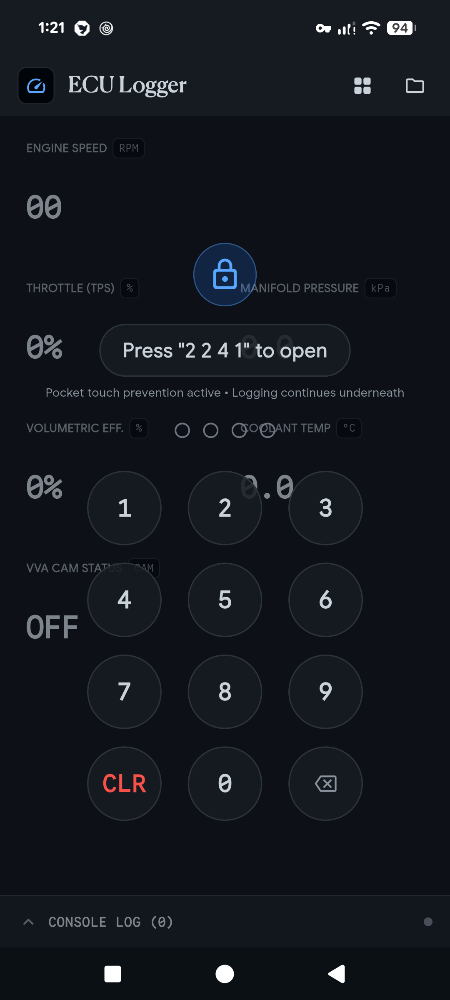
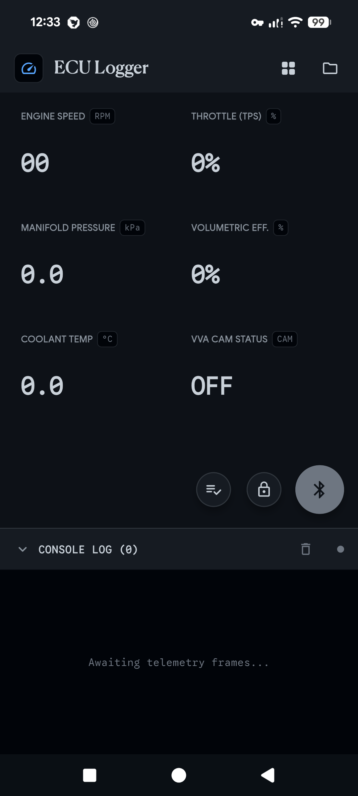
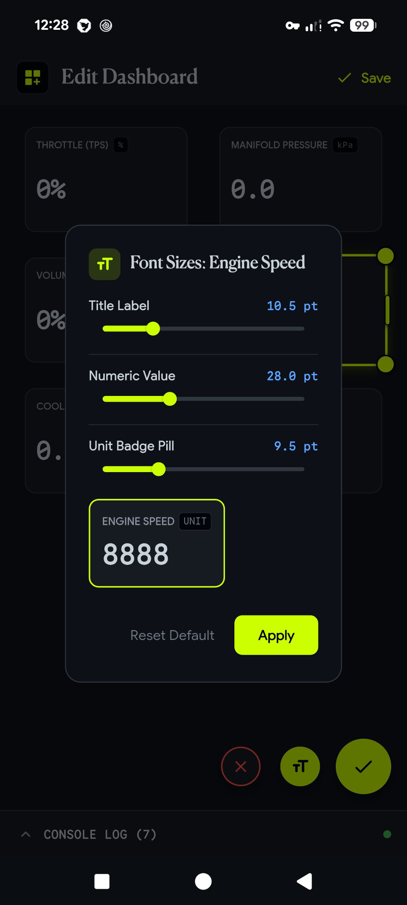
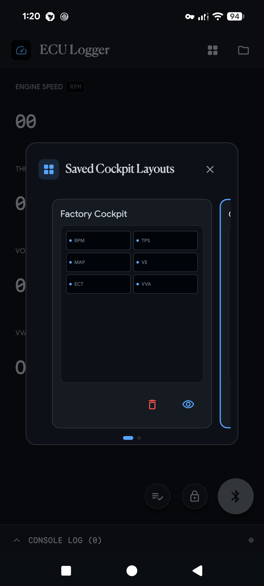

# 🏍️ ECU Logger 📊

🚀 **High-frequency CAN bus and OBD-II telemetry logger for motorcycle ECU tuning and real-time volumetric efficiency analysis. Built with Flutter, featuring customizable cockpit layouts and resilient background data acquisition.**

Built specifically for motorcycle telemetry acquisition and ECU tuning on Android, `ECU Logger` delivers crash-resilient 50–100Hz background logging to your road runs! Whether you are tuning Yamaha low-end fueling, diagnosing VVA camshaft transitions, or recording high-speed CAN streams from a NEXAS NexLink BLE 5.0 adapter, `ECU Logger` provides a high-contrast GitHub Primer cockpit with responsive multi-column card customization and continuous disk logging right out of the box. ⚡

**Live Documentation**: [https://aceburgundy.github.io/ECU-Logger/](https://aceburgundy.github.io/ECU-Logger/)  
**Direct APK Download (`v1.0.2`)**: [Download ecu-logger-v1.0.2.apk](https://github.com/AceBurgundy/ECU-Logger/releases/download/v1.0.2/ecu-logger-v1.0.2.apk)

---

## 📸 Cockpit Showcase

| Normal View Cockpit (2x2 Default Grid) | Interactive Edit Mode (No Idle Jiggle) | Active Card 8-Point Resize Handles |
|:---:|:---:|:---:|
|  |  |  |

| Pocket Touch Lock Overlay | Rolling Console Drawer | Custom Font Size Dialog | Saved Cockpit Layouts |
|:---:|:---:|:---:|:---:|
|  |  |  |  |

---

## 📦 Requirements & Installation

Before running or building, ensure your environment meets the minimum version constraints defined in `pubspec.yaml`:

* **Flutter SDK (`>= 3.5.0 < 4.0.0`):** Cross-platform mobile SDK.
* **Dart SDK (`>= 3.5.0`):** Modern Dart language with sound null safety.
* **Android SDK (`minSdk >= 21`, `targetSdk 34+`):** Android 5.0+ with BLE 5.0 hardware support.
* **NEXAS NexLink BLE 5.0 or ELM327 OBD-II Adapter:** Hardware adapter plugged into the motorcycle CAN diagnostic port.

Clone the repository and install dependencies via Flutter:

```bash
git clone https://github.com/AceBurgundy/ECU-Logger.git
cd ECU-Logger
flutter pub get
```

---

## 🚀 Core Features

* 📱 **Responsive Multi-Column Cockpit (4 / 6 / 8 Columns, 2-Span Default):** Dynamically scales across screen widths while keeping cards at **2-column × 2-row** defaults rendered flush in GitHub Primer dark aesthetics (`#0D1117`):
  * **Phone Portrait (`<600dp`):** 4 grid columns (2 cards per row).
  * **Tablet Portrait / Phone Landscape (`600dp–900dp`):** 6 grid columns (3 cards per row).
  * **Large Tablet / Wide Landscape (`>900dp`):** 8 grid columns (4 cards per row).
* 🎨 **Interactive Fluid Edit Mode & Saved Cockpit Carousel:**
  * **Quiet Smooth Entry & Exit Scale:** Long-pressing enters Edit Mode with a smooth cubic downscale transition without distracting idle jiggle. Selecting **Check (Save)** or **Cancel (Discard)** smoothly animates all cards back to `1.0x` scale.
  * **Drag-Only Jiggle & Physical Slide-Away Reflow:** Holding and dragging a card activates the jiggle animation exclusively for the active drag, while neighboring cards smoothly and physically slide out of the way (`AnimatedPositioned`) to open drop space when hovering over or between cards. Dropping immediately stops the jiggle.
  * **Pixel-Accurate 8-Point Edge & Corner Resizing:** Selecting a card highlights it in Bright Neon Yellow (`0xFFCCFF00`) with 4 corner and 4 edge drag handles. Dragging any edge or corner tracks your hand pixel-for-pixel in real time and snaps cleanly up to the active max columns (`4`, `6`, or `8`) and up to `4` rows.
  * **Contextual Typography Editor (Up to 80.0 pt):** Tapping the glowing Neon Yellow font-size button between Cancel and Save customizes Title, Numeric Value, and Unit pill font sizes up to **80.0 pt** per card with overflow-safe scaling.
  * **Minimalist Saved Layouts Carousel & Deduplication:** Displays miniature real cockpit cards reflecting exact grid positions, spans, and typography—never generic skeletons. Pressing Save deduplicates layouts against the non-deletable `Factory Cockpit` baseline and existing saved presets so identical layouts are never duplicated.
* 🔒 **Translucent Pocket Lock Screen:** Full-page translucent modal with a randomized 4-digit PIN challenge (e.g. `Press "7 2 9 4" to open`) and glove-friendly numeric keypad. Prevents accidental pocket touches while preserving 100% live visibility and background logging.
* 📶 **Color-Coded Bluetooth FAB:** Dynamic floating action button reflecting connection state: Grey (Disconnected), Orange (Scanning / Connecting), Green (Connected & Logging), Red (Error).
* 📁 **Dual-Stream File Storage:** Simultaneously writes raw incoming CAN hex frames (`raw_can_*.log`), structured CSV metrics (`telemetry_*.csv`), and the 16x11 tuning accumulator matrix (`remap_matrix_*.json`).
* ⚡ **Real-Time Speed-Density VE Calculation:** Evaluates thermodynamic Volumetric Efficiency using the ideal gas law and trims it via Short-Term and Long-Term Fuel Trims (`STFT + LTFT`), safely outputting `0.0%` when the engine is off (`RPM == 0`).
* 🔄 **Lifecycle Auto-Save Engine:** Listens to `AppLifecycleState` hooks to automatically flush and save logs when paused, backgrounded, or disconnected.
* 📜 **Collapsible Monospace Log Drawer:** Rolling 200-line console drawer rendered in `Google Sans Code` with instant clear controls and packet counters.

---

## 💻 Quick Start & Usage Examples

### 1️⃣ Installation & Launch ⚙️

Install the latest release APK directly from [GitHub Releases](https://github.com/AceBurgundy/ECU-Logger/releases/latest) ([Direct APK Download](https://github.com/AceBurgundy/ECU-Logger/releases/download/v1.0.2/ecu-logger-v1.0.2.apk)) or build from source:

```bash
flutter run --release
```

### 2️⃣ Pairing with NEXAS NexLink Adapter 📡

Tap the floating Bluetooth button in the bottom right corner of the screen:

```dart
// BleService initiates automated BLE discovery:
await BleService.instance.startScan();

// Discovered devices stream into the GitHub-styled modal:
BleService.instance.deviceListStream.listen((devices) {
  // Select "NEXAS NexLink" (MAC 8C:DE:52:DF:42:C3)
});
```

### 3️⃣ Engaging Pocket Touch Lock 🔒

Before placing your phone into your pocket or riding jacket, tap the Lock FAB beside the Bluetooth button. A translucent overlay activates with a randomized 4-digit PIN challenge while all cockpit metrics and disk logging continue uninterrupted underneath.

---

## 🔗 Links & Documentation

* **Repository & Source Code**: [https://github.com/AceBurgundy/ECU-Logger](https://github.com/AceBurgundy/ECU-Logger)
* **Hosted Documentation (GitHub Pages)**: [https://aceburgundy.github.io/ECU-Logger/](https://aceburgundy.github.io/ECU-Logger/)
* **Latest APK Release**: [https://github.com/AceBurgundy/ECU-Logger/releases/latest](https://github.com/AceBurgundy/ECU-Logger/releases/latest)
* **Issue Tracker**: [https://github.com/AceBurgundy/ECU-Logger/issues](https://github.com/AceBurgundy/ECU-Logger/issues)

---

## 📜 License

This project is licensed and distributed under the **Mozilla Public License (MPL-2.0)**.

---

## 👤 Author

* **Name:** AceBurgundy
* **Email:** samadriansabalo99@gmail.com
